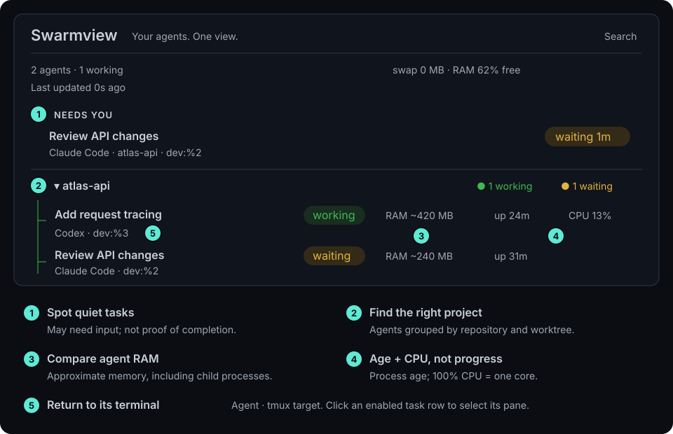

<p align="center"></p>
<h1 align="center">Swarmview</h1>
<p align="center"><strong>Your agents. One view.</strong><br>A local dashboard for AI coding agents.</p>
<p align="center">
  <a href="https://github.com/yukinoda/swarmview/actions/workflows/ci.yml"></a>
  <a href="LICENSE"></a>
  <a href="go.mod"></a>
</p>

## See which coding agent might need you next

Running AI coding agents across several terminals? **Swarmview puts them in one
live dashboard.** Spot quiet agents, compare memory use, and jump back to the
right tmux pane instead of checking every terminal.

Works with **Claude Code, Codex, OpenCode, Gemini, Aider, and Cursor Agent**.
Runs locally: one Go binary, no account, no analytics, no hosted service.

<p align="center"></p>
<p align="center"><sub>Illustrative data. Activity is inferred from CPU use, not a native completion signal.</sub></p>

### Check → choose → continue

1. **Check what might need you.** Recently active agents that go quiet appear
   under **Needs you** after 15 seconds; optionally enable desktop notifications.
2. **Choose a task.** Browse by repository/worktree or press **⌘ K / Ctrl K**
   to search task names, agents, and repositories.
3. **Continue in its terminal.** Click an enabled row to select its tmux pane.
   With Ghostty on macOS, Swarmview also brings the matching terminal view forward.

**Waiting is a hint, not proof that a task is done.** Network and I/O waits can
look quiet too. Monitoring works with any terminal; agents outside tmux are
monitoring-only.

## Download

**[Get the macOS installer or macOS/Linux CLI binaries →](https://github.com/yukinoda/swarmview/releases)**

For the macOS app, choose **arm64** for Apple Silicon or **amd64** for Intel,
then drag **Swarmview.app** to Applications. Requires macOS 13.3 or later.
The app is ad-hoc signed, not notarized; see [first-launch help](desktop/macos/Installation.txt).

## Quick start

Requires **Go 1.27+**, `ps`, and `lsof`. Git enables repository grouping;
tmux is optional for pane selection. Supports macOS and Linux.

```sh
git clone https://github.com/yukinoda/swarmview.git
cd swarmview
go build -trimpath -ldflags='-s -w' -o swarmview .
./swarmview
```

Open **http://127.0.0.1:4777** and run your coding agents as usual.
Use `PORT=4888 ./swarmview` to choose another port.

### macOS desktop app (prototype)

For a dedicated window, run `bash desktop/macos/build.sh`, then
`open dist/Swarmview.app`. Releases include ARM/Intel `.dmg` installers and
`.app.zip` archives. To build a drag-to-Applications image, run
`bash desktop/macos/dmg.sh` after building the app.
Requires macOS 13.3+; ad-hoc signed, not notarized.
[Desktop app setup →](desktop/macos/README.md)

## Read a task row

```text
Add request tracing     working   RAM ~420 MB   up 24m   CPU 13%
└ Task title            Status    Agent RAM    Age      CPU use
  Codex · dev:%3
  └ Agent · tmux target (click the row to return to this pane)
```

| You see | It means |
| --- | --- |
| `RAM ~420 MB` | Approximate RAM of the agent and its child processes; not guaranteed reclaimable memory |
| `up 24m` | How long the process has been running, not time spent on this task |
| `CPU 13%` | Recent CPU use, **not percent complete**. 100% = one core; can exceed 100% |
| `● 2 working` | Two working agents in that repository or worktree |
| `swap … · RAM …% free` | Machine-wide memory indicators on macOS |

Expand **What do these numbers mean?** in the app, or read the
[dashboard guide](GUIDE.md#reading-the-dashboard) for every status, memory color,
and metric.

## Learn more

- [Dashboard guide](GUIDE.md) — statuses, search filters, tmux workflow, and resource use
- [Full dashboard screenshot](assets/screenshot.png) — illustrative multi-repository view
- [Compatibility](COMPATIBILITY.md) — platforms, terminals, dependencies, and limitations
- [Contributing](CONTRIBUTING.md) — development checks and release process
- [Security](SECURITY.md) · [Issues](https://github.com/yukinoda/swarmview/issues) · [Brand assets](assets/README.md)

Licensed under the [MIT license](LICENSE). Independent of the agent and terminal
vendors named above.
