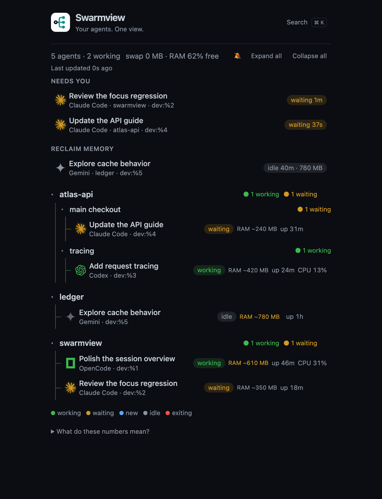

<p align="center"></p>
<h1 align="center">Swarmview</h1>
<p align="center"><strong>Your agents. One view.</strong><br>A local dashboard for AI coding agents.</p>
<p align="center">
  <a href="https://github.com/yukinoda/swarmview/actions/workflows/ci.yml"></a>
  <a href="LICENSE"></a>
  <a href="go.mod"></a>
</p>

## See which coding agent might need you next

Running AI coding agents across several terminals? **Swarmview puts them in one
live dashboard.** Spot quiet agents, compare memory use, and jump back to the
right tmux pane instead of checking every terminal.

Works with **Claude Code, Codex, OpenCode, Gemini, Aider, and Cursor Agent**.
Runs locally: one Go binary, no account, no analytics, no hosted service.

<p align="center"></p>
<p align="center"><sub>Illustrative data in an earlier dashboard layout; CPU and process age now live in Details. Activity is inferred, not a native completion or human-request signal.</sub></p>

### Check → choose → continue

1. **Check what might need you.** Recently active agents that go quiet appear
   under **Recently quiet** as bounded observations; optionally enable desktop
   notifications. Quiet activity is not a confirmed request for help.
2. **Choose a task.** Browse by repository/worktree or press **⌘ K / Ctrl K**
   to search task names, agents, and repositories.
3. **Continue in its terminal.** Click an enabled task identity to select its tmux pane.
   With Ghostty on macOS, Swarmview also brings the matching terminal view forward.

**Quiet is a hint, not proof that a task is done or needs you.** Network and I/O
waits can look quiet too. Monitoring works with any terminal; agents outside tmux are
monitoring-only.

## Download

**[Get the macOS installer or macOS/Linux CLI binaries →](https://github.com/yukinoda/swarmview/releases)**

For the macOS app, choose **arm64** for Apple Silicon or **amd64** for Intel,
then drag **Swarmview.app** to Applications. Requires macOS 13.3 or later.
The app is ad-hoc signed, not notarized; see [first-launch help](desktop/macos/Installation.txt).

## Quick start

Requires **Go 1.27+**, `ps`, and `lsof`. Git enables repository grouping;
tmux is optional for pane selection. Supports macOS and Linux.

```sh
git clone https://github.com/yukinoda/swarmview.git
cd swarmview
go build -trimpath -ldflags='-s -w' -o swarmview .
./swarmview
```

Open **http://127.0.0.1:4777** and run your coding agents as usual.
Use `PORT=4888 ./swarmview` to choose another port.

### macOS desktop app (prototype)

For a dedicated window, run `bash desktop/macos/build.sh`, then
`open dist/Swarmview.app`. Releases include ARM/Intel `.dmg` installers and
`.app.zip` archives. To build a drag-to-Applications image, run
`bash desktop/macos/dmg.sh` after building the app.
Requires macOS 13.3+; ad-hoc signed, not notarized.
[Desktop app setup →](desktop/macos/README.md)

## Read a task row

```text
Task identity                  Process sample    Action
Add request tracing                   working    Details
OpenCode · dev:%3                     ~420 MB
└ Worker abc123                                   Details
  Sent from parent

Details → CPU 13% · Process age: 24m
          (separate control, not a terminal action)
```

| You see | It means |
| --- | --- |
| `~420 MB` in RAM | Approximate RAM of the agent and its child processes; not guaranteed reclaimable memory |
| `—` in RAM | Memory is unavailable, not zero |
| `Process age: 24m` in Details | How long the process has been running, not time spent on this task |
| `CPU 13%` in Details | Recent CPU use, **not percent complete**. 100% = one core; can exceed 100% |
| `2 working` | Two working agents in that repository or worktree |
| `swap … · RAM …% free` | Machine-wide memory indicators on macOS |

RAM stays neutral regardless of agent size. Warning colors reflect actual OS
memory pressure, not swap usage or low free RAM alone. Native human requests and
communication events are unavailable unless a bridge is installed: no CPU- or
nesting-derived message pulses. An optional [OpenCode V2 live bridge](integrations/opencode/README.md)
adds explicit send/foreground-return observations with user-reviewed TUI setup.
The native app listens for it by default (`--no-communication` turns that off);
the CLI needs `-communication`. It never records event history or installs
anything itself. An optional
[Claude Code plugin](integrations/claude/README.md), installed with one
`/plugin install` command, adds subagent start/finish and follow-up message
cues through the same listener.
CLI archives include `integrations/opencode` beside the binary; native apps
include the same review-first files in
`Contents/Resources/integrations/opencode`. Packaging them does not enable the
plugin or change user settings; follow the manual setup linked above.
Use the separate **Details** control for CPU, process age, model and terminal
context. Live metadata-worker rows keep unavailable process metrics in Details
instead of showing empty metric cells; confirmed communication appears as plain
colored text, not a worker activity state. Open **Preferences** for appearance
and opt-in quiet notifications. Read the
[dashboard guide](GUIDE.md#reading-the-dashboard) for status and metric definitions.

## Learn more

- [Dashboard guide](GUIDE.md) — statuses, search filters, tmux workflow, and resource use
- [Annotated dashboard illustration](assets/dashboard-guide.svg) — an earlier layout's numbered guide to task rows and metrics
- [Compatibility](COMPATIBILITY.md) — platforms, terminals, dependencies, and limitations
- [Contributing](CONTRIBUTING.md) — code layout, development checks, and release process
- [Security](SECURITY.md) · [Issues](https://github.com/yukinoda/swarmview/issues) · [Brand assets](assets/README.md)

Licensed under the [MIT license](LICENSE). Independent of the agent and terminal
vendors named above.
